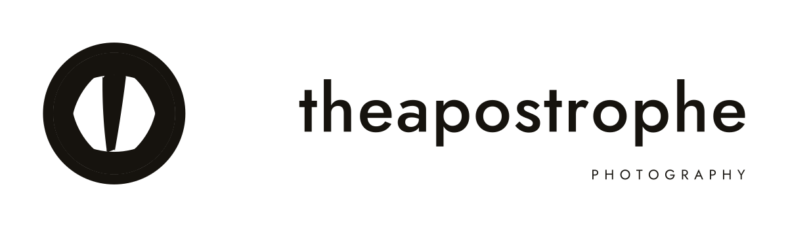
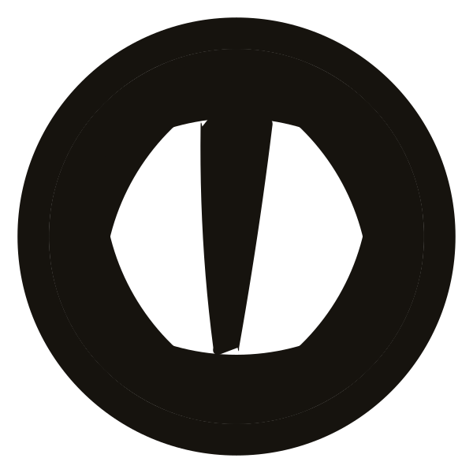

# theapostrophe — vector logo & identity files

Vector identity for **theapostrophe**, a photography business.

Everything here is real vector geometry, built from exact circles, arcs and type outlines —
no autotracing, no embedded fonts, no proprietary software needed to open it.

<p align="center">
  
</p>

<p align="center">
  
</p>

---

## The idea

| | |
|---|---|
| **The mark** | A camera iris — six blades closing around a six-sided opening — with the apostrophe of *theapostrophe* standing in the light of the aperture. |
| **The wordmark** | The name set lowercase in **Jost 500**, converted to outlines. |
| **The tagline** | `PHOTOGRAPHY`, Jost 400, wide tracking, flush right under the wordmark. |
| **Colours** | **Studio Ink** `#16130E` on **Paper** `#F7F3EC`, with **Brass** `#C08F2C` as the only accent. |

The badge is drawn on the same geometry a real lens uses: six circular blade discs of radius
`R − ring`, each cut by the aperture disc, which leaves the faceted hexagonal opening.
The apostrophe is a hand-built tapered wedge (curved shoulders, leaning left) so it rhymes with
the blade corners instead of looking like a pasted-in quote mark.

---

## What's in here

```
assets/                     ← grab-and-go files (best place to start)
  theapostrophe-logo.svg        primary lockup, the main logo
  theapostrophe-logo-white.svg  same, paper white (for dark backgrounds)
  theapostrophe-mark.svg        badge only
  theapostrophe-mark-white.svg
  theapostrophe-stacked.svg     badge over wordmark
  theapostrophe-wordmark.svg    name only
  favicon.svg / app-icon.svg    small-size builds
  preview-*.png                 previews for this readme

build/                      ← generated by `npm run build`
  master/    *.svg          editable masters, 1 unit = 1 mm, outlined type
  print/     *.pdf          vector PDF at true physical size (mm)
  eps/       *.eps          EPS, Level 2, for legacy print pipelines
  png/       *.png          transparent rasters 512 → 4096 px (ink + white)
  jpg/       *.jpg          ready-to-post files on Paper / Studio Ink
  icons/     *.png *.svg    favicons 16–128 px, app icons 180/192/512
  social/    og-1200x630, avatar-1024
  brand/     theapostrophe-identity-sheet.svg / .pdf / .png   (A4)

src/                        ← the build itself
  logokit.py                    small pure-Python vector toolkit (paths, arcs,
                                bool-free geometry, SVG/PDF/EPS writers, type→outlines)
  build_logo.py                 the identity: geometry, lockups, all exports
  fonts/Jost[wght].ttf          Jost variable font + OFL licence

tools/render.js             SVG → PNG/JPEG rasteriser (sharp / librsvg)
theapostrophe-logo-files.zip  the whole package, ready to hand to a printer
index.html                  brand page: previews + download links
```

### Which file do I send where?

| Situation | File |
|---|---|
| Print shop, anything | `build/print/theapostrophe-primary.pdf` (or the EPS if they ask) |
| Printer asks "can I have the vector?" | `assets/theapostrophe-logo.svg` |
| Website / app header | `assets/theapostrophe-logo.svg` (inline or ``) |
| Photo watermark | `build/png/watermark-white-2048.png` |
| Profile picture | `build/social/avatar-1024.png` or `build/png/mark-on-ink-1024.png` |
| Social share card | `build/social/og-1200x630.png` |
| Slide deck / Word | `build/jpg/on-paper-2048.jpg` or a transparent PNG |
| Dark background, photo, T-shirt | `assets/theapostrophe-logo-white.svg` |
| Stamp / foil | `assets/theapostrophe-mark.svg` in Brass `#C08F2C` |

---

## Using it

**Clear space** — keep at least `0.35 × badge diameter` free around every lockup.
The trimmed masters already include it.

**Minimum sizes** — badge no smaller than `8 mm` / `24 px`; wordmark cap height no smaller
than `1.5 mm`. Below 24 px use `favicon.svg` (the simplified, blade-free badge).

**Don't** stretch, rotate, recolour outside the palette, add effects, retype the name in another
typeface, or re-space the letters. If you need the name written in body copy, set it in Jost —
it's free (SIL OFL) and the `.woff2` subset in `assets/fonts/` is the same cut used in the lockups.

### Rebuilding

```bash
python3 -m venv .venv
.venv/bin/pip install fonttools          # converts type → outlines
npm install                              # sharp, for rasterising
npm run build                            # → build/*  (SVG, PDF, EPS, PNG, JPG, icons, social, brand sheet)
```

`src/build_logo.py` is the single source of truth: change a number at the top
(ring thickness, aperture size, apostrophe height, colours, tracking) and every file is rebuilt
in a couple of seconds. Nothing is hand-edited downstream.

---

## Notes

* **Type** — [Jost](https://github.com/indestructible-type/Jost) by indestructible type*,
  SIL Open Font License 1.1 (`src/fonts/OFL.txt`). The `woff2` subsets in `assets/fonts/`
  are reduced versions of the same font and stay under the OFL.
* **Files** — SVG masters are pure paths (no fonts, no dependencies). PDFs are written by
  `logokit` directly, so they open anywhere a PDF does. EPS is Level 2 with outlined paths.
* **Code** — the build scripts are MIT licensed (see `LICENSE`); the logo artwork itself
  belongs to theapostrophe.
